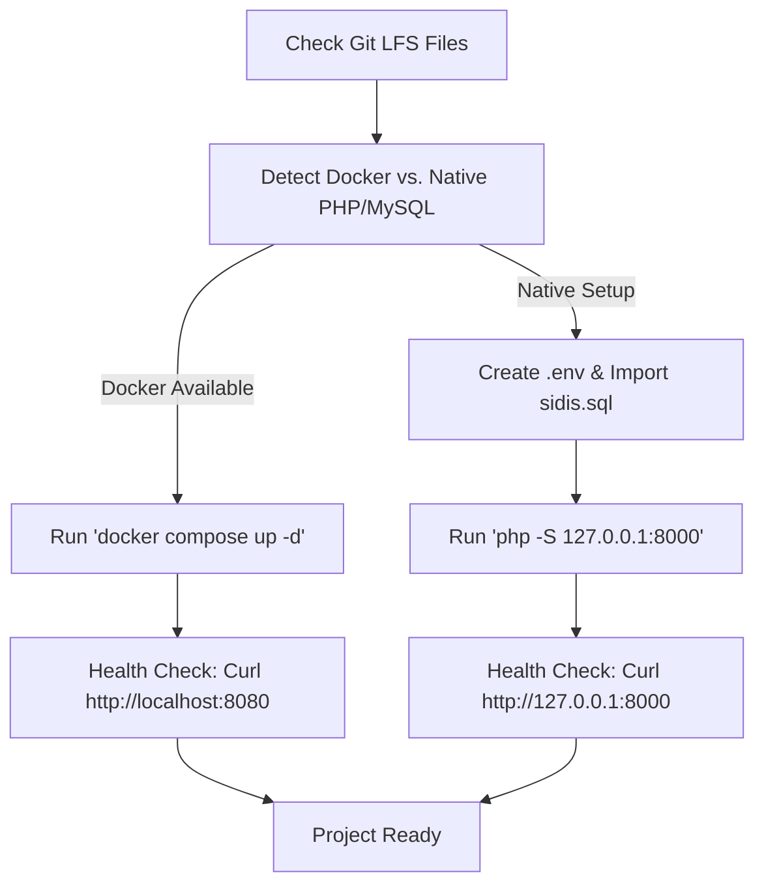

# SIDIS — School of Interdisciplinary Studies Web Portal

A full-stack institutional web portal and Content Management System (CMS) for the **School of Interdisciplinary Studies (SIDIS)**, IIT Madras. The project includes a public-facing website, an administrative CMS dashboard, and an authenticated self-service faculty portal.

---

## Table of Contents

- [Overview](#overview)
- [Key Features](#key-features)
- [Tech Stack](#tech-stack)
- [Directory Structure](#directory-structure)
- [Prerequisites](#prerequisites)
- [Quick Start Guide](#quick-start-guide)
  - [Method 1: Docker Compose (Recommended / Easiest)](#method-1-docker-compose-recommended--easiest)
  - [Method 2: Native PHP & MySQL (Local Dev)](#method-2-native-php--mysql-local-dev)
  - [Method 3: XAMPP / MAMP / LAMP](#method-3-xampp--mamp--lamp)
- [Database Setup & Configuration](#database-setup--configuration)
- [Default Accounts & Authentication](#default-accounts--authentication)
  - [Resetting or Creating an Admin Password](#resetting-or-creating-an-admin-password)
- [Application Portals & Routes](#application-portals--routes)
- [File Uploads & Permissions](#file-uploads--permissions)
- [AI Agent Automated Setup & Discovery Guide](#ai-agent-automated-setup--discovery-guide)
- [Troubleshooting](#troubleshooting)

---

## Overview

SIDIS is an academic portal designed to showcase multidisciplinary research, interdisciplinary academic programs (B.Tech, M.Tech, M.S., Ph.D.), research clusters, and faculty directory. It also includes:
1. **Public Website**: Academic programs, research clusters, committees, dynamic news, announcements, and recruitment listings.
2. **Admin Dashboard (`/admin`)**: Content management for hero banners, announcements, news, clusters, faculty members, consultative committees, and user logins.
3. **Faculty Portal (`/admin/faculty-portal`)**: Dedicated portal for faculty members to manage their individual academic profiles, publications (journals, conferences, books, patents), education, and teaching schedules.

---

## Key Features

- **Dynamic Cluster & Faculty Pages**: Displays inner profiles, research focus, and publications dynamically from the database.
- **Role-Based Access Control**: Strict segregation between `admin` and `faculty` roles.
- **Faculty Self-Service Portal**: Allows professors to update their publications and biographies without admin intervention.
- **Media Management**: Structured upload pipelines for images, PDFs, attachments, and high-definition video assets managed with Git LFS.
- **Responsive Frontend**: Mobile-ready layout powered by custom styles and Bootstrap.

---

## Tech Stack

- **Backend**: PHP 8.0+ (compatible with PHP 8.1, 8.2, 8.3)
- **Database**: MySQL 8.0+ / MariaDB 10.4+ using PHP Data Objects (`PDO`) with `utf8mb4` charset
- **Frontend**: Vanilla PHP, HTML5, CSS3, JavaScript, Bootstrap 5, FontAwesome
- **Version Control & Large Assets**: Git + [Git LFS](https://git-lfs.github.com/) (for video and high-resolution assets)

---

## Directory Structure

```plaintext
sidis/
├── admin/                         # Admin CMS & Management Portal
│   ├── faculty-portal/            # Faculty member self-service portal
│   │   ├── index.php              # Faculty dashboard
│   │   ├── profile.php            # Faculty profile details
│   │   ├── journals.php           # Journal publications
│   │   ├── conferences.php        # Conference publications
│   │   └── ...                    # Patents, books, education, teaching
│   ├── account_helpers.php        # CSRF, Base64 chunk helpers & auth utils
│   ├── announcements.php          # Announcement management
│   ├── clusters.php               # Research clusters management
│   ├── faculty.php                # Faculty directory management
│   ├── login.php                  # Unified Login (Admin & Faculty tabs)
│   ├── news.php                   # News & events management
│   ├── users.php                  # User & credential administration
│   └── index.php                  # Admin dashboard
├── bootstrap/                     # Bootstrap 5 assets (CSS & JS bundles)
├── fonts/                         # Custom web fonts
├── images/                        # Static and dynamic image uploads
│   ├── attachments/               # Uploaded PDFs and documents
│   ├── clusters/                  # Cluster banners and icons
│   ├── faculty/                   # Faculty profile portraits
│   └── staff/                     # Staff images
├── .env.example                   # Template for environment configuration
├── config.php                     # Central database connection handler (PDO)
├── dbchanges.txt                  # Database migration reference script
├── docker-compose.yml             # Turnkey Docker deployment setup
├── Dockerfile                     # Apache + PHP 8.2 with PDO container
├── sidis.sql                      # Complete database schema and initial seed data
├── index.php                      # Public homepage
├── about.php                      # About SIDIS page
├── faculty.php                    # Public faculty directory
├── innerfaculty.php               # Detailed individual faculty profile
├── clusters.php                   # Research clusters listing
├── innercluster.php               # Detailed cluster overview
└── style.css                      # Global stylesheets
```

---

## Prerequisites

Ensure the following tools are installed on your machine:
- **Git** with **Git LFS** (`git-lfs`)
- For Docker Setup: **Docker** & **Docker Compose**
- For Native Setup:
  - **PHP 8.0 or newer** with extensions: `pdo_mysql`, `mbstring`, `fileinfo`
  - **MySQL 8.0+** or **MariaDB 10.4+**

---

## Quick Start Guide

### Method 1: Docker Compose (Recommended / Easiest)

Docker Compose provides a one-command setup that starts both the Apache/PHP web server and the MySQL database with `sidis.sql` automatically loaded.

1. **Clone the repository with Git LFS**:
   ```bash
   git clone https://github.com/samjoshua2002/sidis.git
   cd sidis
   git lfs pull
   ```

2. **Start the containers**:
   ```bash
   docker compose up -d --build
   ```

3. **Verify the application**:
   - Public Website: [http://localhost:8080/](http://localhost:8080/)
   - Admin Login: [http://localhost:8080/admin/login.php](http://localhost:8080/admin/login.php)
   - MySQL service is exposed at `localhost:3306` with user `root` and password `rootpassword`.

4. **Stop the containers**:
   ```bash
   docker compose down
   ```

---

### Method 2: Native PHP & MySQL (Local Dev)

If you have PHP and MySQL installed directly on your machine:

1. **Clone the repository**:
   ```bash
   git clone https://github.com/samjoshua2002/sidis.git
   cd sidis
   git lfs pull
   ```

2. **Configure Environment Variables**:
   Copy `.env.example` to `.env`:
   ```bash
   cp .env.example .env
   ```
   Open `.env` and set your database connection details:
   ```ini
   DB_HOST=127.0.0.1
   DB_NAME=sidis
   DB_USER=root
   DB_PASS=your_mysql_password
   ```

3. **Create the Database and Import Schema**:
   Run the following commands using the MySQL CLI:
   ```bash
   mysql -u root -p -e "CREATE DATABASE IF NOT EXISTS sidis CHARACTER SET utf8mb4 COLLATE utf8mb4_unicode_ci;"
   mysql -u root -p sidis < sidis.sql
   ```

4. **Start the PHP Built-in Server**:
   From the root of the project directory, run:
   ```bash
   php -S 127.0.0.1:8000
   ```

5. **Access the Site**:
   - Public Website: [http://127.0.0.1:8000/](http://127.0.0.1:8000/)
   - Admin Login: [http://127.0.0.1:8000/admin/login.php](http://127.0.0.1:8000/admin/login.php)

---

### Method 3: XAMPP / MAMP / LAMP

1. **Move files into document root**:
   - Copy or symlink the `sidis` folder to your server's web root (e.g., `C:/xampp/htdocs/sidis` on Windows or `/Applications/MAMP/htdocs/sidis` on macOS).
2. **Create the database in phpMyAdmin**:
   - Open [http://localhost/phpmyadmin](http://localhost/phpmyadmin)
   - Create a database named `sidis` (Collation: `utf8mb4_unicode_ci`).
   - Click **Import** and select `sidis.sql`.
3. **Configure `.env`**:
   - In the `sidis` root directory, create `.env`:
     ```ini
     DB_HOST=127.0.0.1
     DB_NAME=sidis
     DB_USER=root
     DB_PASS=
     ```
4. **Access the Application**:
   - Public: `http://localhost/sidis/`
   - Admin: `http://localhost/sidis/admin/login.php`

---

## Database Setup & Configuration

The application centralizes its database connection in `config.php`:
- It reads `.env` using PHP's `parse_ini_file()`.
- If `.env` is absent, it seamlessly falls back to system environment variables (`getenv()`) or local defaults (`127.0.0.1`, database `sidis`, user `root`, empty password).

### Key Tables in `sidis.sql`

| Table Name | Description |
|---|---|
| `users` | Accounts for `admin` and `faculty` roles with bcrypt hashed passwords |
| `faculty` | Faculty profiles, designations, contact details, research, and biography |
| `clusters` | Interdisciplinary research clusters (e.g., Quantum, Robotics, Sustainability) |
| `announcements` | Urgent notices and campus broadcasts |
| `news_events` | News items and event agendas |
| `journalpub` | Journal publication listings for faculty |
| `confrncepub` | Conference publication listings for faculty |
| `indpublication` | Books, book chapters, and general publication records |
| `hero_section` | Slides and text displayed in the homepage carousel |
| `recruitment` | Job advertisements and career listings |

---

## Default Accounts & Authentication

The authentication system at `/admin/login.php` provides two separate login tabs:
1. **Admin Tab**: For administrators managing the CMS.
2. **Faculty Tab**: For faculty members managing their profile and publications.

### Default Users in `sidis.sql`

| Username | Role | Notes |
|---|---|---|
| `admin-si-di-s` | `admin` | Main administrative account |
| `ravindra` | `faculty` | Sample faculty account (Faculty ID 153) |

### Resetting or Creating an Admin Password

Passwords are encrypted using PHP `password_hash()` with the `BCRYPT` algorithm.

To set the password for `admin-si-di-s` to `admin123`, run either of the following:

#### Option 1: Via PHP Command Line
```bash
php -r '
require "config.php";
$hash = password_hash("admin123", PASSWORD_BCRYPT);
$pdo->prepare("UPDATE users SET password = ? WHERE username = ?")->execute([$hash, "admin-si-di-s"]);
echo "Admin password updated to admin123\n";
'
```

#### Option 2: Via Direct SQL Query
```sql
UPDATE `users`
SET `password` = '$2y$10$wKrnUq7Q/qS7Fz.X0wI6hO1pE1yY5Ua.d1/NqIomN13v82oM0HqG.'
WHERE `username` = 'admin-si-di-s';
```
*(The hash above corresponds to password: `admin123`)*

---

## Application Portals & Routes

| URL Route | Purpose |
|---|---|
| `/index.php` | Main public landing page |
| `/about.php` | About the school, vision, and mission |
| `/faculty.php` | Public faculty directory with filters (Core, Adjunct, Associate) |
| `/innerfaculty.php?id=<ID>` | Dedicated faculty profile page |
| `/clusters.php` | Research clusters overview |
| `/innercluster.php?id=<ID>` | Research cluster details and members |
| `/apply.php` | Admissions and application guide |
| `/recruitment-page.php` | Open faculty and staff career opportunities |
| `/admin/login.php` | Login screen for Admin and Faculty portals |
| `/admin/index.php` | Admin CMS dashboard |
| `/admin/users.php` | User management & password reset requests |
| `/admin/faculty-portal/index.php` | Faculty self-service dashboard |

---

## File Uploads & Permissions

The application allows image and document uploads for faculty portraits, cluster icons, announcements, and PDFs. Ensure write permissions are granted to the upload directories:

```bash
chmod -R 775 images/
chmod -R 775 images/attachments images/faculty images/clusters images/staff
```

If running in Linux/Apache environments, verify that the web server user (`www-data` or `apache`) has ownership:
```bash
sudo chown -R www-data:www-data images/
```

---

## AI Agent Automated Setup & Discovery Guide

If you are an autonomous AI agent or automated CI pipeline configuring and running this project, follow this deterministic checklist:



1. **Verify Git LFS**:
   Check if `images/Director-cyber security course-030726_1.mp4` is a pointer or binary. If it is a pointer (<1KB), run:
   ```bash
   git lfs pull
   ```
2. **Environment Configuration**:
   Ensure `.env` exists in the repository root:
   ```bash
   test -f .env || cp .env.example .env
   ```
3. **Database Initialization**:
   Execute the initial dump `sidis.sql` into the targeted MySQL/MariaDB database.
4. **Execution**:
   - If Docker is running: `docker compose up -d --build`
   - If native PHP: `php -S 127.0.0.1:8000`
5. **Automated Verification**:
   Verify HTTP status 200:
   ```bash
   curl -s -o /dev/null -w "%{http_code}\n" http://127.0.0.1:8000/
   curl -s -o /dev/null -w "%{http_code}\n" http://127.0.0.1:8000/admin/login.php
   ```

---

## Troubleshooting

### 1. `git-lfs: command not found` or Corrupted Media
- **Symptom**: Images or MP4 video files appear corrupted or empty after cloning.
- **Fix**: Install Git LFS (`brew install git-lfs` on macOS, `sudo apt-get install git-lfs` on Ubuntu) and run `git lfs install && git lfs pull`.

### 2. `Database connection failed: SQLSTATE[HY000] [2002]`
- **Symptom**: The homepage displays `Database connection failed`.
- **Fix**:
  1. Verify MySQL server is active (`brew services list`, `systemctl status mysql`, or `docker ps`).
  2. Verify credentials in `.env` match your MySQL host, username, password, and database name.
  3. On macOS/Linux, try `DB_HOST=127.0.0.1` instead of `localhost` to force TCP connection rather than Unix socket.

### 3. Missing `pdo_mysql` PHP Extension
- **Symptom**: PHP throws `could not find driver`.
- **Fix**: Enable `extension=pdo_mysql` in your `php.ini` file or install the package (e.g. `sudo apt install php-mysql`).

### 4. File Upload Errors
- **Symptom**: Uploading photos or attachments in the Admin panel fails with `move_uploaded_file failed`.
- **Fix**: Verify write permissions for the `images/` directory and ensure `upload_max_filesize` and `post_max_size` in `php.ini` are at least `64M`.

---

## License & Credits

Developed for the **School of Interdisciplinary Studies (SIDIS)**, Indian Institute of Technology Madras (IIT Madras).
All institutional trademarks, logos, and materials belong to their respective owners.

